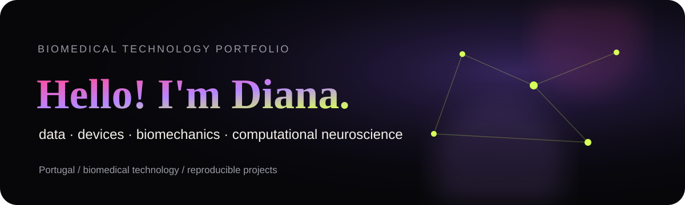
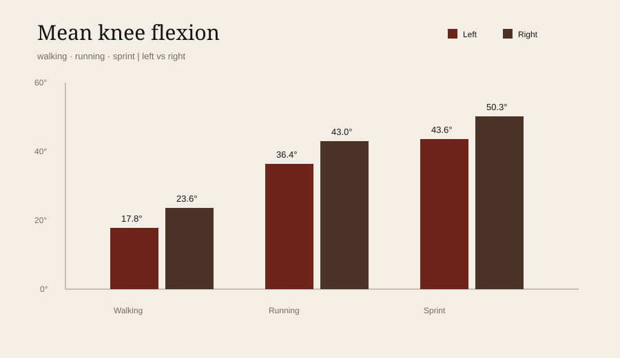

<p align="center">
  
</p>

<table>
<tr>
<td width="31%" valign="top">


### Diana Alves

**Biomedical Technology student**<br />
Portugal 🇵🇹

[](https://diana-neurotech-portfolio.vercel.app)
[](https://orcid.org/0009-0008-1557-2729)
[](https://github.com/dianaalves397)

</td>
<td width="69%" valign="top">

## 🚀 About me

I am completing a degree in **Biomedical Technology at ESTSetúbal, Polytechnic Institute of Setúbal**, building academic experience in biomedical engineering, data and signal processing.

My academic knowledge spans biomedical systems, electronics, instrumentation, statistics, databases, biomechanics, biomaterials, medical devices and life sciences. My current direction includes **computational neuroscience, neural decoding, computational motor control and neurotechnology**.

- 📡 Developing foundations in **digital signal processing with MATLAB**
- 🦾 Interested in **motor control, BCI and neuroprosthetics**
- 📊 Working across **Python, MATLAB, statistics and biomedical data analysis**
- 🧪 Applying coursework in **biomechanics, biomedical product design and information systems**
- 🩺 Expanding into **medical software, regulatory strategy and quality systems**

### ✦ Current focus

`biomedical technology` · `biomedical data` · `medical devices` · `motor behaviour` · `computational neuroscience`

</td>
</tr>
</table>

---

## 🛠 Capabilities

### Demonstrated through projects

| Area | Demonstrated work |
| --- | --- |
| Signal processing coursework | Synthetic sampled signals, descriptive analysis, autocorrelation, moving-average smoothing and zero-crossing detection |
| Programming & biomedical data | Python, NumPy, pandas, Matplotlib, exploratory data analysis and file/data processing |
| MATLAB & digital signal processing | MATLAB scripts/functions, sinusoidal signal generation, descriptive metrics, autocorrelation, moving-average FIR filters, mean removal, zero-crossing detection and CSV export |
| Biomechanics & human movement | Qualisys motion capture, 3D marker trajectories, knee-angle calculation, force-platform gait timing, symmetry and variability analysis |
| Biomedical CAD / product design | Autodesk Fusion assembly work, mechanical component integration and a gait-assistance design concept |
| Biomedical information systems | Relational modelling, MySQL project architecture, Python/pandas/SQLAlchemy ETL and Power BI analysis in team coursework |
| Engineering practice | Git/GitHub, programming exercises, technical documentation, critical interpretation and reproducible data workflows |
| Web | HTML, CSS and JavaScript used to build this editorial portfolio |

### Academic knowledge

Competencies studied and applied through **Biomedical Technology** coursework, projects and laboratory work:

| Area | Academic knowledge |
| --- | --- |
| Biomedical Electronics & Instrumentation | Analog electronics; diodes, BJT and MOSFET; circuit analysis, simulation, assembly and measurements; sensors, transducers, operational/differential amplification, analog filters, ADC/DAC, signal conditioning and biomedical acquisition |
| Statistics & Data | Descriptive statistics, probability and distributions, sampling and estimation, confidence intervals, parametric/non-parametric hypothesis tests, chi-square, Wilcoxon/Mann–Whitney, regression, correlation, residual analysis, R and biomedical-data interpretation |
| Databases | Relational databases, entity–relationship modelling, normalization, SQL and data manipulation; XML, XML Schema/DTD, XPath and information modelling |
| Biomaterials | Biomaterial–tissue interaction and biocompatibility; stainless steel, titanium alloys, CoCr and Nitinol; ceramics, calcium phosphates, polymers, hydrogels and composites; drug delivery, coatings, characterization and degradation |
| Biomechanics | Newtonian mechanics, statics and dynamics, forces and moments, free-body diagrams, center of mass, kinematics, biomechanics and quantitative human-movement analysis |
| Medical Devices | Risk classification, regulation and vigilance fundamentals; diagnostic, monitoring, implantable, surgical and life-support devices; biomedical equipment, electrical safety, limitations and error sources |
| Biomedical & Molecular Sciences | Human anatomy and physiology, biochemistry, cell and molecular biology, membranes and transport, extracellular matrix, proteins, DNA/RNA, gene expression and regulation, cell cycle, apoptosis, mutations and introductory PCR, electrophoresis and sequencing concepts |
| Medical Product Development | Needs, requirements and specifications; concept generation and selection, product architecture, prototyping, technical drawing, CAD/3D-modelling fundamentals and prosthesis, orthosis, implant and rehabilitation-device design contexts |
| Digital Health | Digital-health fundamentals, telemedicine, health information technologies and remote-healthcare concepts |

[**→ Explore the interactive capability atlas**](https://diana-neurotech-portfolio.vercel.app#capabilities)

---

## 🧪 Selected Biomedical Technology coursework

### MATLAB Signal Processing Foundations (PSM)

A documented collection of original **MATLAB** coursework in **digital signal processing**. The exercises cover synthetic discrete-time sinusoids, signal descriptors (maximum/minimum, peak-to-peak, mean, standard deviation, energy and power), autocorrelation using `xcorr`, moving-average **FIR** smoothing, mean removal, and zero-crossing counting with and without **hysteresis**. The project includes the 13 uploaded `.m` source files and the supplied CSV.

**Status:** educational work and code drafts, including identified mistakes and incomplete scripts. The example named `ECG` is a **synthetic sinusoid**, not a biological signal or validated medical analysis.

[**→ Explore the MATLAB signal-processing project**](projects/psm-matlab-foundations) · [**→ MATLAB code**](projects/psm-matlab-foundations/matlab)

### Biomechanics Gait Analysis

A full walking/running/sprint laboratory analysis using **Qualisys motion capture**, 3D lower-limb markers and force-platform data. The project includes the actual equations, aggregated experimental tables and derived visualisations.

<p align="center">
  
</p>

Key outputs include knee-flexion profiles, GT/ELF/ML trajectories, support/no-contact timing, step/stride timing, symmetry index, coefficient of variation and marker velocity/acceleration.

[**→ Open the full gait-analysis project**](projects/biomechanics-gait-analysis) · [**→ Results**](projects/biomechanics-gait-analysis/docs/results.md) · [**→ Data tables**](projects/biomechanics-gait-analysis/data)

### Gait Trainer — CAD Assembly

A biomedical product-design project developed in **Autodesk Fusion**, with an assembly-level gait-assistance concept, mechanical components, casters, fasteners and an Arduino-related enclosure.

<p align="center">
  
</p>

[**→ Open the CAD project**](projects/gait-trainer-cad) · [**→ Open/download the Fusion `.f3z` project**](https://drive.google.com/file/d/1bwisNnG-afc3zUxBcT_GuxmCJDgMlcfR/view?usp=drivesdk)

### Diabetes Data Explorer

A modular Python biomedical-data project using **pandas, NumPy and Matplotlib**. The repository includes the full source code, preprocessing, statistics, generated result tables and tests.

```text
src/
├── main.py
├── utils.py
├── preprocessing.py
└── stats.py
```

[**→ Open the Diabetes project**](projects/diabetes-data-explorer) · [**→ Browse the Python source**](projects/diabetes-data-explorer/src) · [**→ Results**](projects/diabetes-data-explorer/results)

### Prosthesis Data Management System

A relational biomedical-information-system project connecting **patients, physicians, technicians, laboratories, prostheses, examinations, consultations, medical problems and medical equipment**.

The project exposes its architecture and analysis artefacts:

```text
prosthesis-data-management/
├── data-model.md
├── schema.sql
├── etl_example.py
└── powerbi-results.md
```

It covers ER modelling, primary/foreign keys, many-to-many bridge tables, data cleaning, Python/pandas/SQLAlchemy loading into MySQL and analytical Power BI views.

[**→ Open the full database project**](projects/prosthesis-data-management) · [**→ ER model**](projects/prosthesis-data-management/data-model.md) · [**→ SQL schema**](projects/prosthesis-data-management/schema.sql) · [**→ Power BI results**](projects/prosthesis-data-management/powerbi-results.md)


---

## 🌐 Biomedical Technology Portfolio

The same work is presented as a **Cosmos-inspired editorial visual portfolio** curated around Biomedical Technology projects, methods and technical capabilities.

<p align="center">
  <a href="https://diana-neurotech-portfolio.vercel.app">
    
  </a>
</p>

The website source is in the root of this repository (`index.html`, `style.css`, `script.js`) and deploys through Vercel.

---

## 📈 GitHub stats

<p align="center">
  
  
</p>

---

## 🧭 Biomedical Technology direction

```text
Biomedical Technology
        ↓
Biomedical systems + electronics + data + life sciences
        ↓
Biomechanics + medical devices + biomedical software
        ↓
Computational neuroscience (future interest)
        ↓
Biomedical innovation + remote-ready technical work
```

<p align="center"><sub>Biomedical Technology · build carefully · document clearly · make the work findable.</sub></p>
